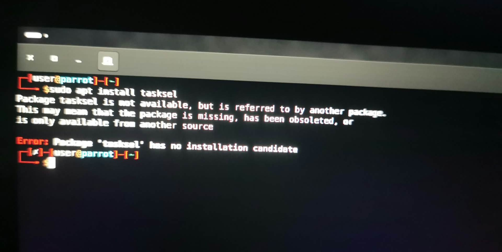
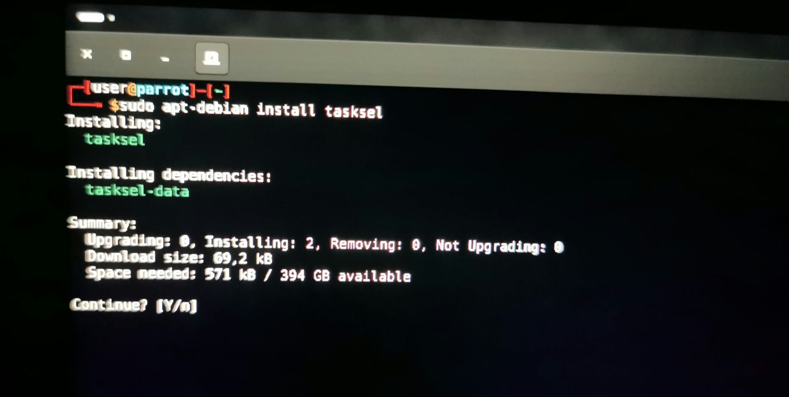

# APT Debian Isolation Tool (`apt-debian`)

A lightweight wrapper script for `apt` and `apt-cache` that allows you to manage packages from a specific, isolated Debian repository (e.g., Debian Bookworm) without mixing them with your main system repositories.

## Problem & Solution

On distributions like Parrot OS or other derivatives, certain packages might not be available or may have missing installation candidates in the default system sources:



Using `apt-debian`, you can seamlessly pull and install packages directly from your isolated Debian repository list:



## Installation

1. Create your isolated repository list file:
   ```bash
   sudo nano /etc/apt/debian-bookworm.list
   ```
   Add your repository sources (e.g., Debian Bookworm):
   ```text
   deb http://deb.debian.org/debian bookworm main contrib non-free non-free-firmware
   ```

2. Create the script file:
   ```bash
   sudo nano /usr/local/bin/apt-debian
   ```
   Paste the following script content:

   ```bash
   #!/bin/bash

   DEBIAN_LIST="/etc/apt/debian-bookworm.list"

   if [[ $EUID -ne 0 ]]; then
       echo "Please run with sudo."
       exit 1
   fi

   if [[ ! -f "$DEBIAN_LIST" ]]; then
       echo "File not found: $DEBIAN_LIST"
       exit 1
   fi

   APT_OPTS=(
       -o Dir::Etc::sourcelist="$DEBIAN_LIST"
       -o Dir::Etc::sourceparts="-"
   )

   case "$1" in
       update)
           apt "${APT_OPTS[@]}" update
           ;;
       install)
           shift
           apt "${APT_OPTS[@]}" install "$@"
           ;;
       remove)
           shift
           apt "${APT_OPTS[@]}" remove "$@"
           ;;
       purge)
           shift
           apt "${APT_OPTS[@]}" purge "$@"
           ;;
       clean)
           shift
           apt "${APT_OPTS[@]}" autoremove
           apt "${APT_OPTS[@]}" clean
           echo "Removed unused packages and cleared package cache."
           ;;
       search)
           shift
           apt-cache "${APT_OPTS[@]}" search "$@"
           ;;
       show-all)
           apt-cache "${APT_OPTS[@]}" pkgnames | sort
           ;;
       show-installed|installed)
           comm -12 <(apt-cache "${APT_OPTS[@]}" pkgnames | sort) <(dpkg-query -W -f='${Package}\n' | sort)
           ;;
       show)
           if [[ "$2" == "all" ]]; then
               apt-cache "${APT_OPTS[@]}" pkgnames | sort
           elif [[ "$2" == "installed" ]]; then
               comm -12 <(apt-cache "${APT_OPTS[@]}" pkgnames | sort) <(dpkg-query -W -f='${Package}\n' | sort)
           else
               shift
               apt-cache "${APT_OPTS[@]}" show "$@"
           fi
           ;;
       *)
           echo "Usage:"
           echo "  sudo apt-debian update"
           echo "  sudo apt-debian install <package>"
           echo "  sudo apt-debian remove <package>"
           echo "  sudo apt-debian purge <package>"
           echo "  sudo apt-debian clean"
           echo "  sudo apt-debian search <package>"
           echo "  sudo apt-debian show <package>"
           echo "  sudo apt-debian show-all"
           echo "  sudo apt-debian show-installed"
           ;;
   esac
   ```

3. Make the script executable:
   ```bash
   sudo chmod +x /usr/local/bin/apt-debian
   ```

## Usage

* **Update local package index:**
  ```bash
  sudo apt-debian update
  ```
* **Install a package:**
  ```bash
  sudo apt-debian install <package>
  ```
* **Remove a package:**
  ```bash
  sudo apt-debian remove <package>
  ```
* **Purge a package (remove with config files):**
  ```bash
  sudo apt-debian purge <package>
  ```
* **Clean cache and autoremove dependencies:**
  ```bash
  sudo apt-debian clean
  ```
* **Search for packages:**
  ```bash
  sudo apt-debian search <package>
  ```
* **Show package details:**
  ```bash
  sudo apt-debian show <package>
  ```
* **List all available packages in the repository:**
  ```bash
  sudo apt-debian show-all
  ```
* **List installed packages from this repository:**
  ```bash
  sudo apt-debian show-installed
  ```
